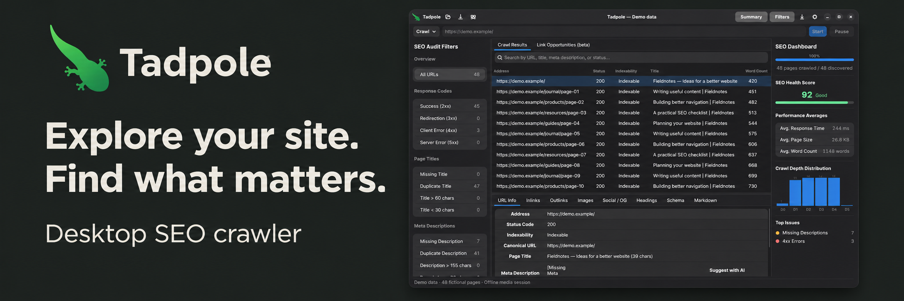
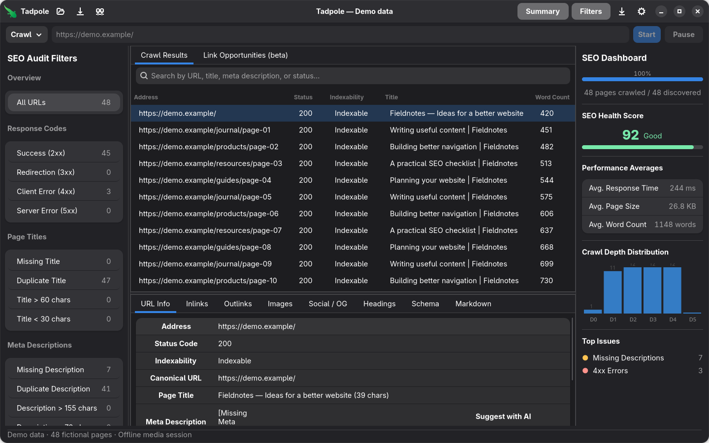

<p align="center">
  
</p>

<h1 align="center">Tadpole</h1>

<p align="center"><strong>Find SEO issues. Understand your internal links. Turn a crawl into a plan.</strong></p>

Tadpole is an open-source desktop SEO crawler for **Linux and Windows**. Inspect a site's metadata and indexability, explore its structure, and export the evidence—all from a native desktop workspace. Crawl results stay on your machine; optional AI suggestions use your own provider account.

<p align="center">
  <a href="https://github.com/piotrowskiadam/Tadpole/releases/latest"><strong>Download for Linux &amp; Windows</strong></a>
  &nbsp;·&nbsp;
  <a href="https://github.com/piotrowskiadam/Tadpole/issues">Report an issue</a>
  &nbsp;·&nbsp;
  <a href="docs/DEVELOPMENT.md">Developer guide</a>
</p>

<p align="center">
  <a href="https://snapcraft.io/tadpole">
    
  </a>
</p>

<p align="center">
  <a href="https://ko-fi.com/B5Z022ZL32">
    
  </a>
</p>

## See your audit in one workspace

<p align="center">
  
</p>

*Actual application capture using 48 fictional pages. Demo scores and timings are illustrative.*

Move from the site overview to the page that needs attention: filter the crawl, select a URL, inspect its details, then export the findings you want to work on.

| What you need to find | What Tadpole gives you |
| --- | --- |
| Pages that need attention | HTTP status, indexability, titles, descriptions, canonical URLs, headings and image checks. |
| Patterns across a site | Searchable results, duplicate and missing-metadata filters, and a summary of recurring issues. |
| How pages connect | Inlinks, outlinks, internal-link opportunities and six views of site structure. |
| More than a page title | Wrapping link tables with anchors and targets, image previews with resolution and alt text, social preview cards, JSON-LD diagnostics and extracted Markdown. |
| Evidence you can use elsewhere | Filtered CSV export, spreadsheet-friendly copying, Markdown files and saved `.seocrawl` projects. |

## Explore the structure behind the URLs

A long URL list can hide the shape of a website. Open the **site visualizer** to explore it from different angles:

| View | Use it to explore |
| --- | --- |
| **Directory area** | Compare the size of site sections in a treemap. |
| **Directory icicle** | Follow nested URL paths through a directory hierarchy. |
| **Link-depth tree** | Inspect shortest link paths and how deeply pages sit in the crawl. |
| **URL links** | Examine the link neighborhood around a selected page. |
| **Section links** | Compare connections between sections in a matrix. |
| **Depth + rank** | Compare crawl depth with calculated internal rank. |

Directory views can be weighted by URL count, page bytes, words, pages with issues, internal rank or response time. These views describe the collected crawl; they do not represent Google's ranking signals.

## Start with the scope you need

1. **Choose your scope:** a website, a path, one page, or an explicit list of URLs.
2. **Set your boundaries:** URL and depth limits, concurrency, include/exclude patterns, redirects and robots.txt handling.
3. **Crawl and investigate:** search results, use the audit filters, inspect page details and open the visualizer.
4. **Take the next step:** export filtered findings or save a project to reopen later.

The default crawl limit is 500 URLs and can be changed in Preferences. Optional JavaScript rendering requires a compatible Chrome/Chromium installation; it is not bundled. In Flatpak, that browser must be available inside the sandbox.

## Install Tadpole

Choose a package from the [latest release](https://github.com/piotrowskiadam/Tadpole/releases/latest):

| Platform | Packages |
| --- | --- |
| Linux | **Flatpak**, DEB, RPM, AppImage and Snap |
| Windows | **Installer EXE** or portable ZIP |

For the GitHub Flatpak bundle, download `tadpole-x86_64.flatpak`, then run:

```sh
flatpak remote-add --user --if-not-exists flathub https://dl.flathub.org/repo/flathub.flatpakrepo
flatpak install --user ./tadpole-x86_64.flatpak
flatpak run com.tadpole.seo
```

The upstream Flatpak is distributed through GitHub. See the [Flatpak guide](docs/FLATPAK.md) for runtime setup and sandbox limitations. Close any running native Tadpole instance before launching the Flatpak.

The AppImage requires compatible host GTK **4.12+** and Libadwaita **1.5+** libraries. Snap Store updates happen separately from GitHub releases. Windows packages have not been independently validated on a clean Windows machine. All current release packages target x86_64.

## Optional AI help, when you ask for it

Get page-level **title, description and image alt-text suggestions** through OpenRouter or OpenAI. In **Preferences → AI Assistant**, enter your API key and choose a model. Then request suggestions from a selected page's details.

Ordinary crawling requires no AI account. AI requests run only when you initiate them and are billed to your provider account. Review suggestions before using them; alt-text suggestions use page text, not image pixels.

<details>
<summary><strong>What is sent to the AI provider, and how are credentials handled?</strong></summary>

A page-level AI action sends the page URL, metadata, headings and up to 12,000 characters of page text to your chosen provider. Requests have timeouts and input/output limits, with no automatic paid requests or application-level retries.

API credentials stay in memory for the session and must be entered again after restarting. They are excluded from project files and config debug output; embedded legacy project keys are ignored. Older files may still contain keys saved by previous versions—remove those keys and rotate them if the files were shared.

</details>

## Know what the crawl can tell you

- SEO health is a local heuristic, not a Google score.
- Schema diagnostics check syntax and selected fields; they do not certify rich-result eligibility.
- Pages with no links from the seed cannot be discovered by following links. Supply known orphan URLs in List mode.
- Crawling sends requests to the websites you audit. Optional AI actions send selected page content to the chosen provider.

For implementation details and current limitations, see the [developer guide](docs/DEVELOPMENT.md).

## Build, contribute and create demos

Tadpole uses Rust, GTK4 and Libadwaita. Building the desktop app requires a current stable Rust toolchain with edition 2024 support, GTK **4.12+**, Libadwaita **1.5+**, a C compiler, pkg-config and a graphical desktop.

Ubuntu 24.04:

```sh
sudo apt-get install build-essential pkg-config libgtk-4-dev libadwaita-1-dev
cargo run --locked
```

Fedora:

```sh
sudo dnf install gcc pkgconf-pkg-config gtk4-devel libadwaita-devel
cargo run --locked
```

Core tests run without GTK development packages:

```sh
cargo test --locked --no-default-features
```

To create screenshots or short walkthroughs with fictional data, use the opt-in media mode:

```sh
TADPOLE_MEDIA_MODE=1 cargo run --locked
```

The separate capture tools save app-window PNGs or record at 2 fps for up to 60 seconds. [The media guide](docs/MEDIA.md) explains GIF/MP4 conversion and capture limitations.

Read the [development guide](docs/DEVELOPMENT.md) before changing crawl execution or persistence. Add regression tests for changes to crawling, parsing, provider responses and stored data; keep provider tests offline and never commit credentials or real crawl files.

[Architecture](ARCHITECTURE.md) · [Modernization audit](docs/AUDIT.md) · [Visualization design study](docs/visualization/index.html) · [Visualization research](docs/research/seo-visualizations.md) · [Performance baseline](VISUALIZATION_BENCHMARKS.md) · [MIT license](LICENSE)

## Support Tadpole

If Tadpole helps with your audits, you can support its development on Ko-fi. Bug reports and practical feedback are welcome through [GitHub Issues](https://github.com/piotrowskiadam/Tadpole/issues).

<p>
  <a href="https://ko-fi.com/B5Z022ZL32">
    
  </a>
</p>

## How Tadpole is developed

Tadpole is developed primarily by orchestrating AI coding agents, including Google's Antigravity, OpenAI's Codex, and OpenCode. An SEO professional with many years of experience sets the feature direction and checks the application after each update. Read the [AI development disclosure](AI_DISCLOSURE.md) for the scope and the distinction from the optional AI features inside the app.
